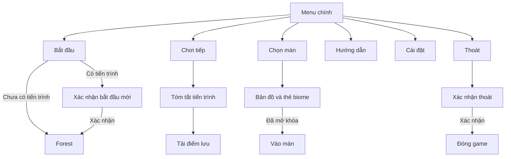

# BROTATO 2D — KẾ HOẠCH THIẾT KẾ VÀ TRIỂN KHAI GIAO DIỆN MENU

> **Tệp đích trong repository:** `docs/HEXCORE_MENU_UI_PLAN.md`  
> **Trạng thái:** Đã chọn Concept B · Đại chiến sinh tồn và chuyển giao diện vào `Assets/Scenes/MainMenu.unity`. Mở scene rồi nhấn Play để duyệt trong Unity.
> **Dự án:** Brotato-Game · Unity 2D · Top-down Action Roguelite Survival.  
> **Tên game:** BROTATO 2D. **HEXCORE** là hệ thống nâng cấp và phát triển sức mạnh trong game, không phải tên game.

## 1. Mục tiêu và các quyết định thiết kế

Xây dựng menu hiện đại, vui mắt, nhiều năng lượng, có bản sắc riêng và chất lượng hình ảnh cao. Khi mở game, người chơi phải cảm nhận được không khí chiến đấu sinh tồn, nhiều hệ nhân vật và sự nhộn nhịp của thế giới BROTATO 2D.

- Phong cách **Stylized Cartoon Action / Dynamic Game UI**: trẻ trung, rực rỡ có kiểm soát, sinh động, giàu tính giải trí; không phải UI Pixel Art retro, kiếm hiệp cổ điển, Dark Fantasy u ám hoặc Modern Minimalist đơn điệu.
- Tham khảo tinh thần hình ảnh của **Ember Knights** và **Autogun Heroes: Supercharged**, kết hợp năng lượng giao diện của **Brawl Stars**. Không sao chép logo, nhân vật, hình ảnh quảng bá hoặc bố cục nhận diện của các game đó.
- Sử dụng nhân vật, quái vật, vũ khí và tài nguyên thực tế trong dự án. Thể hiện ba hệ Súng, Cận chiến và Pháp sư bằng các tạo hình có thật; không tự sáng tạo nhân vật mới để lấp chỗ trống.
- Giữ nguyên đồ họa Pixel Art, sprite, animation, gameplay và các scene hiện có trong trận. Có thể tạo minh họa stylized dành riêng cho menu dựa trên đúng tạo hình gốc, không ghi đè asset gameplay.
- Menu chính có đúng sáu chức năng: **Bắt đầu · Chơi tiếp · Chọn màn · Hướng dẫn · Cài đặt · Thoát**. Không thêm nút chế độ, thành tựu, cửa hàng, phòng luyện tập hay chức năng khác ngoài phạm vi.
- Chọn màn sử dụng bản đồ hành trình kết hợp thẻ ảnh toàn cảnh của bốn biome hiện có: Forest, Moon, Inferno, Tundra.
- Giai đoạn A: làm đủ ba demo Main Menu trực quan để người dùng lựa chọn. Giai đoạn B: chỉ sau khi người dùng duyệt concept mới tạo MainMenu Scene chính thức và hoàn thiện các màn phụ.

## 2. Nguồn tham khảo và kiểm kê đầu vào

Hai hình ảnh người dùng cung cấp:

| Mẫu | Điểm cần học hỏi | Không được sao chép |
| --- | --- | --- |
| Ember Knights — `image(20261127-140441).png` | Logo lớn nổi bật; nhóm anh hùng có màu năng lượng riêng; tư thế chiến đấu rõ; quái bao quanh; bố cục nhiều lớp và cao trào thị giác. | Logo, nhân vật đầu lửa, hình nền, key art gốc. |
| Autogun Heroes: Supercharged — `image(20261127-140446).png` | Hai phe đối đầu; quỹ đạo đạn và năng lượng dẫn mắt; nhân vật có cá tính; không khí hỗn chiến vui nhộn, tương phản màu mạnh. | Logo, tạo hình anh hùng/quái, vũ khí đặc trưng và key art gốc. |

Brawl Stars là tham khảo tinh thần UI trẻ trung, nút nổi khối, phản hồi nhanh và bố cục có cá tính, không phải yêu cầu sao chép giao diện hay cơ chế của game đó.

Hai ảnh tham khảo cần được người dùng đính kèm cho Codex hoặc đặt vào thư mục tham khảo riêng. Tệp Markdown này không nhúng ảnh và không giả định các ảnh đã tồn tại trong repository.

### 2.1. Audit bắt buộc trước khi sản xuất

Đọc `AGENTS.md`, `docs/STATE.md`, `docs/ARCHITECTURE.md` và các tài liệu thực tế về menu, hệ Súng, Cận chiến, Pháp sư, HEXCORE, map, wave, nhân vật, quái vật và giấy phép tài nguyên. Nếu đường dẫn khác, tìm đúng file trong repo; không tạo tài liệu hoặc hệ thống trùng lặp.

Đối chiếu `ProjectSettings/ProjectVersion.txt` để sử dụng đúng phiên bản Unity của checkout hiện tại. Plan cũ ghi 6000.3.22f1; báo cáo kỹ năng từng dùng 6000.3.25f1. Không mặc định một phiên bản nếu chưa kiểm tra.

Lập inventory có đường dẫn asset thật: prefab/sprite/animation của ba hệ; quái đang có; VFX đạn, kiếm khí, phép thuật; tilemap bốn biome; UI/font/audio hiện có; nguồn và giấy phép. Đánh dấu rõ asset dùng được, cần chỉnh, cần tạo mới, thiếu hoặc chỉ có ở sân thử. Không tự suy diễn tên, thông số và cơ chế gameplay chưa có.

### 2.2. Hiện trạng theo Plan trước (cần xác minh lại)

- `GameScene` là scene gameplay đang bật build; bốn biome Forest, Moon, Inferno, Tundra cùng scene, do `MapManager` điều phối. `WaveManager` từng dùng chung cấu hình wave 30 giây trong Inspector.
- `CharacterProgressionTest`, `Magical` và các scene demo Cận chiến có nội dung thử nghiệm; không coi các cơ chế của sân thử là gameplay chính thức.
- Có thể tận dụng `SwordsmanVisual.prefab`, sprite/clip các hệ, atlas icon Mage, Roboden tileset nếu nguồn và giấy phép đã được xác minh. Goblin từng được ghi nhận có trong game chính; các quái/boss khác cần kiểm tra trước khi đưa vào hướng dẫn.
- Gameplay từng đọc WASD, ngắm chuột và tự bắn; việc đổi phím chiến đấu cần kiểm tra pipeline input hiện tại. Không thay đổi gameplay để làm đẹp menu.

## 3. Định hướng mỹ thuật chung

### 3.1. Key art chiến trường

Thay bối cảnh Kiếm sĩ đứng trước kiếm đài cổ bằng một cảnh chiến đấu sống động. Ba hệ Súng, Cận chiến và Pháp sư có tư thế đặc trưng, tương tác với quái vật và môi trường. Không giới hạn cả ba hệ vào tạo hình kiếm sĩ.

- Súng: tư thế ngắm/bắn, hiệu ứng đạn và phản lực phù hợp vũ khí thật.
- Cận chiến: tư thế vung kiếm/đao, kiếm khí hoặc vệt chém có quỹ đạo hợp lý.
- Pháp sư: tụ phép, pháp trận hoặc năng lượng có dấu hiệu nhận diện riêng.
- Quái: sử dụng mẫu thật của dự án, bố trí để gợi xung đột và nguy cơ sinh tồn.
- HEXCORE: điểm nhấn năng lượng phụ trợ cho chủ đề phát triển sức mạnh, không cạnh tranh với logo BROTATO 2D.

Tạo chiều sâu bằng tiền cảnh, trung cảnh, hậu cảnh, ánh sáng và phối cảnh. Các hiệu ứng dẫn mắt về nhân vật hoặc điểm xung đột; chừa vùng tương phản ổn định cho logo và nút. Nhộn nhịp không có nghĩa là nhồi tất cả hiệu ứng vào một khung hình.

Nếu chuyển thể sprite pixel thành minh họa hiện đại, phải đối chiếu hình dáng, tóc, trang phục, màu sắc, vũ khí và đặc điểm nhận diện với asset gốc. Tạo một bản đối chiếu asset nguồn ↔ minh họa menu. Không dùng nhân vật của mẫu tham khảo hoặc ảnh chung chung không liên quan.

### 3.2. Logo, màu sắc và UI

- Logo **BROTATO 2D** lớn, đậm, nổi khối, sắc nét, có cá tính như nhận diện game hành động; `2D` là một phần của logo. Không dùng font pixel hoặc font mặc định thiếu xử lý. Logo phải đọc tốt ở kích thước nhỏ và lớn.
- Bảng màu gợi ý để thử, chưa khóa: xanh tím `#202747`, vàng `#FFC83D`, cyan `#35D9E8`, cam san hô `#FF7952`, tím sáng `#9A79F5`, xanh lá `#65D991`. Mỗi concept được phép dùng bảng màu riêng phù hợp bố cục.
- Nút chính **Bắt đầu** nổi bật nhất, có trọng lượng thị giác rõ. Các nút khác có thứ bậc, icon đồng nhất, hình khối và điểm nhấn riêng; không phải sáu hình chữ nhật mặc định giống hệt nhau. Sáng tạo nhưng vẫn có nhãn đầy đủ tiếng Việt, dễ nhận biết và dễ bấm.
- Font sans-serif đậm, hiện đại cho tiêu đề/nút; font đọc tốt cho nội dung dài. Noto Sans là lựa chọn dự phòng từ Plan cũ, kiểm tra glyph tiếng Việt và giấy phép của font cuối cùng.
- Component dùng chung: nút, tab, thẻ biome, nút bản đồ, thẻ nhân vật/kỹ năng, keycap, slider, hộp thoại, tooltip, thông báo lỗi. Trạng thái Normal/Hover/Focus/Pressed/Selected/Disabled phải khác nhau cả hình thức lẫn nhãn khi cần.
- Không lạm dụng viền dày, glow, blur, bounce, chữ nghiêng, texture và gradient. Dùng màu/độ sáng để tạo phân cấp, không chỉ dựa vào màu để báo trạng thái.

## 4. Giai đoạn A — Ba concept demo Main Menu

Mỗi concept phải khác thật sự về bố cục, góc nhìn, vị trí logo, nhân vật, nút, màu sắc và cách dẫn mắt. Không chỉ đổi màu trên cùng một layout. Các ý tưởng dưới đây là brief thiết kế, không phải mockup cuối đã được duyệt.

| Concept | Trọng tâm | Bố cục và hành động | Màu gợi ý | UI |
| --- | --- | --- | --- | --- |
| **A — Hội tụ chiến binh** | Tinh thần Ember Knights; phiêu lưu và hoành tráng. | Ba hệ hợp lực ở trung tâm, hướng hành động tạo thành cụm chiến đấu; quái vật bao quanh; logo lớn phía trên. Mỗi hệ có màu năng lượng riêng. | Tím/xanh sâu, vàng, cyan, tím sáng; nhân vật nổi bật trên nền. | Cụm nút bên cạnh hoặc phía dưới, chừa vùng key art chính. |
| **B — Đại chiến sinh tồn** | Tinh thần Autogun Heroes; vui nhộn, bùng nổ. | Anh hùng và quái vật đối đầu hai phía; đường đạn, kiếm khí, phép thuật dẫn mắt vào điểm giao tranh; góc nhìn chéo giàu động năng. | Cam, vàng, cyan, xanh lá; tương phản nóng/lạnh. | Cụm nút lệch về vùng nền yên, nút Bắt đầu mang dấu ấn hành động rõ. |
| **C — Đấu trường HEXCORE** | Tinh thần Brawl Stars; trẻ trung, năng động. | Ba hệ tạo đội hình trên sân khấu hành động, lõi HEXCORE tạo điểm nhấn, quái/hiệu ứng ở nhiều lớp xung quanh. Bố cục mang chất graphic design. | Xanh tím, vàng rực, cyan, san hô; các mảng màu rõ. | Nút nổi khối, kích thước có phân cấp, bố cục linh hoạt nhưng đúng sáu chức năng. |

### 4.1. Chuyển động và âm thanh

- Nhân vật Idle, biểu diễn vũ khí hoặc ra đòn theo chu kỳ; lệch pha giữa các nhân vật để cảnh có sức sống. Đòn bắn/chém/phép phải khớp vũ khí, hướng nhìn và điểm tác động; không dùng sprite đứng yên với VFX ngẫu nhiên.
- Quái vật chuyển động phụ ở tiền/hậu cảnh. Parallax nhẹ, lá/bụi/hạt năng lượng, ánh sáng và các vệt hiệu ứng. Vùng UI luôn đứng yên và đọc được.
- Logo có intro ngắn, có thể bỏ qua; không bắt người chơi chờ một animation dài mỗi lần mở menu.
- Hover/focus phản hồi nhanh, scale/bounce nhẹ, viền hoặc màu thay đổi; pressed có cảm giác bấm. Không làm layout nhảy hoặc vùng click di chuyển bất thường.
- Nhạc nền vui tươi, phiêu lưu, tiết tấu chiến đấu; SFX riêng cho focus, xác nhận, quay lại, cảnh báo. Không dùng nhạc hoặc SFX của game tham khảo nếu không có quyền.
- Có tùy chọn giảm chuyển động, tắt âm thanh; không tự phát audio trước khi trình duyệt cho phép ở prototype web.

### 4.2. Hình thức demo

Ưu tiên prototype HTML/CSS/JS chạy cục bộ, không cần dịch vụ bên ngoài; nếu công cụ khác phù hợp hơn thì ghi rõ lý do. Đây là phương án thử nhanh trước Unity, không phải yêu cầu chuyển gameplay sang web.

Đề xuất thư mục riêng (điều chỉnh theo repo):

```text
menu-preview/
  index.html           # Màn chọn A/B/C, chỉ phục vụ review
  concepts/
    a/
    b/
    c/
  assets/              # Bản sao asset dành riêng cho demo
  review/              # Screenshot, video/GIF, bảng đối chiếu
  README.md            # Hướng dẫn chạy và các giới hạn
```

- Có trang chọn concept để mở nhanh A/B/C, hoặc phím chuyển concept ngoài sáu chức năng menu; không đưa công cụ review vào Main Menu chính thức.
- Mỗi concept có bố cục hoàn chỉnh 1920×1080 (16:9), kiểm tra thêm 1280×720; asset thực tế, logo, sáu nút, animation và tương tác chuột/bàn phím.
- Nút có hover/focus/pressed thật. Khi nhấn có thể hiển thị panel/fixture nhẹ để kiểm tra điều hướng và trạng thái; không giả vờ đã kết nối lưu game, mở khóa hay tải scene thật.
- Mô phỏng Chơi tiếp có/không có dữ liệu, Chọn màn có khóa, hộp thoại Bắt đầu mới/Thoát. Có thể dùng chung panel thử nghiệm giữa ba concept; mục tiêu vòng này là duyệt thẩm mỹ Main Menu, không bắt buộc làm ba bộ màn phụ hoàn chỉnh.
- Xuất ảnh chụp của từng concept (1920×1080 và 1280×720), ảnh so sánh ba concept, video/GIF có chuyển động nếu công cụ cho phép. Dùng ảnh từ bản preview chạy thật, không dùng ảnh tham khảo làm ảnh kết quả.
- Nếu không có công cụ sản xuất minh họa chất lượng cao, dùng asset thật và mô tả phần còn thiếu; không dùng placeholder rồi báo hoàn thành. Không nhúng hotlink ảnh game khác làm background.

### 4.3. Cổng duyệt A

Hoàn thành cả ba concept trong một nhiệm vụ, tự kiểm thử và sửa lỗi, không hỏi xác nhận giữa các concept. Bàn giao:

1. Đường dẫn và hướng dẫn mở demo, cách chuyển A/B/C.
2. Screenshot từng mẫu, video/GIF khi khả thi, bảng màu, logo, trạng thái nút.
3. Danh sách asset thật và asset minh họa mới kèm nguồn/giấy phép.
4. So sánh ưu nhược điểm: sức hút, nhận diện BROTATO 2D, độ nhộn nhịp, độ rõ UI, độ nhất quán với nhân vật gốc, khả năng dựng Unity, chi phí asset và hiệu năng.
5. Những giới hạn/chưa hoàn thành và đề xuất concept tốt nhất có lý do.

**Dừng tại cổng duyệt này.** Chỉ người dùng được quyết định concept cuối cùng hoặc phối hợp các yếu tố từ nhiều concept. Không tạo MainMenu.unity chính thức, thay đổi scene khởi động, Build Profiles, gameplay, lưu game hoặc mở khóa màn trước khi được duyệt. Không tự đánh dấu Approved.

## 5. Cấu trúc chức năng chính thức (áp dụng cho concept đã chọn)



Tất cả màn phụ có Quay lại. ESC đóng lớp trên cùng (hộp thoại → màn phụ → menu chính); tại menu chính mở xác nhận thoát. Khi đóng panel trả focus về nút đã mở. Hỗ trợ chuột, ↑/↓, Tab/Shift+Tab, ←/→ cho tab/bản đồ, Enter/Space xác nhận; không để focus lạc sau chuyển cảnh. Nút vô hiệu hóa có lý do đọc được, không chỉ đổi sang màu xám.

### 5.1. Bắt đầu

Khởi tạo hành trình mới từ Forest theo cấu hình khởi đầu gameplay đã chốt. Không tự thêm chọn nhánh tiến hóa trước trận hoặc chọn độ khó nếu gameplay chưa có. Nếu có điểm lưu, hiển thị màn/mốc đang lưu và hậu quả của việc bắt đầu mới. Mặc định focus Quay lại; chỉ thay điểm lưu khi hành trình mới được tạo thành công. Không xóa dữ liệu mở khóa màn và thành tích đã lưu (quy tắc đề xuất, xem mục 7).

### 5.2. Chơi tiếp

Thẻ hành trình sinh động, ảnh biome, tên màn, mốc tiếp tục, thời điểm lưu gần nhất, hệ/nhánh/cấp và các thông tin có thật trong dữ liệu. Nút Vào hành trình tải điểm lưu hợp lệ. Nếu không có lưu hoặc lưu hỏng, nút Chơi tiếp bị vô hiệu hóa với lý do rõ ràng. Không bịa số liệu nhân vật.

### 5.3. Chọn màn

Bản đồ hành trình bên trái và ảnh toàn cảnh biome/thẻ thông tin bên phải là bố cục tham chiếu. Ở khung hẹp có thể xếp dọc; giữ cảm giác khám phá, không chỉ là danh sách nút.

| Biome | Hướng mỹ thuật đề xuất |
| --- | --- |
| Forest | Xanh lá, ánh nắng, lá/bụi nhẹ; thiên nhiên sống động. |
| Moon | Xanh tím, ánh sáng lạnh, địa hình theo tilemap thật. |
| Inferno | Cam đỏ, dung nham/tàn lửa nếu đúng asset biome. |
| Tundra | Xanh băng, trắng, tuyết/gió nếu đúng asset biome. |

Bốn biome giữ đúng tên và thứ tự hiện có; đối chiếu repo để xác nhận nội dung. Khi chuyển biome, ảnh, màu nhấn và chuyển động môi trường đổi mượt. Mỗi thẻ có tên, ảnh, mô tả, trạng thái, điều kiện mở khóa, độ khó, kỷ lục và quái/boss nếu có dữ liệu chính thức. Dữ liệu chưa chốt dùng “Chưa xếp hạng”, “Chưa có thành tích” hoặc ẩn mục tương ứng.

Màn hoàn thành có dấu xác nhận; màn mở có viền nổi; màn khóa có biểu tượng và giải thích. Có thể chọn màn khóa để đọc thông tin nhưng không thể Vào màn. Vào màn và Quay lại luôn rõ ràng.

### 5.4. Hướng dẫn (bao gồm Giới thiệu)

Thư viện hiện đại, nhiều hình minh họa, thẻ nhân vật, icon kỹ năng, nội dung cuộn; bỏ cách trình bày sách cổ nặng nề. Không thêm nút Thư viện ở menu chính.

| Tab | Nội dung |
| --- | --- |
| Thế giới | Giới thiệu BROTATO 2D, bối cảnh và mục tiêu sinh tồn; cốt truyện chưa duyệt phải đánh dấu bản nháp. |
| Cách chơi | Vòng sinh tồn, HP, điều kiện thắng/thua, điều khiển thực tế. |
| Nhân vật | Ba hệ Súng, Cận chiến, Pháp sư; tạo hình, phong cách, nhánh tiến hóa. Cận chiến gồm Sát thủ, Đao sĩ, Kiếm khí; nhánh khác đọc catalog thật. |
| HEXCORE & kỹ năng | Cơ chế phát triển sức mạnh, kỹ năng chủ động/bị động, lõi, nâng cấp, icon, mô tả, animation minh họa; số liệu, phím và mốc mở khóa lấy từ tài liệu đã duyệt. Có nút Xem động tác khi có clip phù hợp. |
| Quái vật | Hình, tên, hành vi, khu vực và cách đối phó theo dữ liệu thật; boss nếu đã có. |
| Nhóm phát triển | Thành viên, vai trò, công nghệ và ghi công tài nguyên theo danh sách xác nhận. |

Nội dung từ `CharacterProgressionTest`, `Magical`, demo Cận chiến hoặc sân thử khác phải ghi rõ “Đang thử nghiệm” nếu chưa tích hợp gameplay chính thức. Không nhầm 24 kỹ năng Cận chiến với tổng số kỹ năng cả ba hệ.

### 5.5. Cài đặt

| Tab | Nội dung |
| --- | --- |
| Âm thanh | Tổng, Nhạc, Hiệu ứng; có nghe thử. |
| Đồ họa | Toàn màn hình/cửa sổ, độ phân giải thiết bị hỗ trợ; thêm FPS/VSync nếu có yêu cầu. |
| Điều khiển | Bảng phím hiện hành; chỉ hỗ trợ đổi phím thật khi pipeline input đã hỗ trợ. |
| Hiệu ứng | Mức chuyển động menu, rung camera, mật độ VFX phụ; không làm mất tín hiệu nguy hiểm hoặc thay đổi gameplay. |

Có Áp dụng, Khôi phục mặc định, Quay lại. Thay đổi chưa áp dụng được xem trước và hoàn nguyên nếu người dùng bỏ thay đổi. Đổi độ phân giải hỏi Giữ/Hoàn tác và tự hoàn tác sau 15 giây. Khôi phục mặc định hỏi xác nhận; lưu độc lập với tiến trình game.

### 5.6. Thoát

Hộp thoại xác nhận “Bạn có chắc chắn muốn thoát khỏi BROTATO 2D?” có Quay lại và Thoát game. Mặc định focus Quay lại. Chỉ đóng ứng dụng khi xác nhận.

### 5.7. Loading và định hướng UI mở rộng

Màn hình tải sau khi kết nối game thật dùng ảnh biome/nhân vật, animation ngắn, tiến trình tải thực tế và mẹo chơi đúng gameplay. Không kéo dài thời gian tải giả chỉ để phát animation. Nếu lỗi tải, trở lại panel trước và thông báo rõ. Pause, Victory/Game Over có thể tái sử dụng bộ component sau này; không tự mở rộng phạm vi triển khai hiện tại.

## 6. Giai đoạn B — Unity Scene sau khi duyệt concept

Chỉ thực hiện sau khi nhận lựa chọn rõ ràng của người dùng. Cập nhật tài liệu với concept đã chốt và các thay đổi cụ thể; dựng chính xác thiết kế đã duyệt, không quay lại phong cách pixel/kiếm đài cũ.

### 6.1. Cấu trúc kỹ thuật dự kiến

```text
MainMenu.unity
  Main Camera / Backdrop Camera (nếu cần)
  Backdrop
    FarEnvironment
    BattleActors
    CombatVFX
    Foreground
  MainCanvas
    HomePanel
    ContinuePanel
    StageSelectPanel
    GuidePanel
    SettingsPanel
    LoadingPanel
  ModalCanvas
    ConfirmationDialog
    ErrorDialog
  EventSystem
  MenuController
  MenuBackdrop
  MenuSceneLoader
  Audio (tái sử dụng manager nếu có)
```

Dùng uGUI, TMP, `InputSystemUIInputModule` và action map UI nếu phù hợp với dự án hiện tại. Không tạo EventSystem hoặc manager trùng. Chia panel/component prefab tái sử dụng; không bắt buộc mỗi màn phụ là một scene riêng.

| Thành phần | Trách nhiệm dự kiến |
| --- | --- |
| MenuController | Điều hướng panel, modal, focus, ESC. |
| MenuBackdrop | Điều phối lớp cảnh, animation, parallax, giảm chuyển động. |
| MenuSceneLoader | Nhận yêu cầu tải game, chặn nhấn lặp, xử lý lỗi và loading thực tế. |
| SettingsController | Bản nháp, áp dụng, hoàn tác, khôi phục mặc định, lưu cài đặt. |
| StageCatalog | ScriptableObject hoặc cơ chế catalog hiện có chứa thông tin trình bày biome. |
| GuideCatalog | Dữ liệu hướng dẫn, hệ, kỹ năng, quái và trạng thái thử nghiệm. |
| Save/Progress adapter | Đọc trạng thái lưu/mở khóa đã duyệt; fixture trong demo, dữ liệu thật sau tích hợp. |

Đây là tên định hướng; kiểm tra code thật và ưu tiên tái sử dụng hệ thống đang có. Không áp đặt kiến trúc làm hỏng GameScene.

### 6.2. Bố cục, asset và hiệu năng

- CanvasScaler tham chiếu 1920×1080, anchor/layout phù hợp; kiểm thử 1280×720, 1920×1080, 2560×1080, 1024×768. Nội dung dài cuộn; vùng bấm tối thiểu khoảng 44 px tại độ phân giải thấp nhất hỗ trợ.
- Vùng an toàn cho logo, nhân vật và nút khi crop nền. Font UI/TMP sắc nét; texture UI/minh họa lọc theo art thực tế, không áp Point cho toàn bộ menu hiện đại. Asset pixel gameplay giữ nguyên import setting.
- Dùng texture/sprite atlas, 9-slice nếu thích hợp, pooling VFX hoặc loop có kiểm soát. Không spawn quái/đạn vô hạn; không chạy AI, wave hay gameplay thật trong cảnh trang trí.
- Chuyển cảnh UI ngắn, mượt, có thể dùng khoảng 100–200 ms cho tương tác và 300 ms cho fade làm điểm xuất phát; điều chỉnh theo demo đã duyệt. Giảm chuyển động loại bỏ parallax/bounce mạnh và hạt phụ, giữ phản hồi trạng thái rõ.
- AudioMixer hoặc hệ thống âm thanh hiện có cho Tổng/Nhạc/Hiệu ứng, không tạo audio loop trùng khi đổi panel/scene.

## 7. Quy tắc gameplay và dữ liệu — cần xác nhận trước khi nối thật

Các mục dưới đây kế thừa đề xuất của Plan trước, **không phải cơ chế đã xác nhận tồn tại**. Người dùng duyệt thẩm mỹ demo không đồng nghĩa tự động duyệt mọi quy tắc lưu game. Trong Giai đoạn A dùng fixture. Trong Giai đoạn B chỉ tích hợp phần đã được xác nhận; nếu chưa xác nhận, báo rõ giới hạn và không can thiệp gameplay.

| Quyết định | Phương án đề xuất |
| --- | --- |
| Bắt đầu | Hành trình mới từ Forest; không xóa mở khóa và kỷ lục trước đó. |
| Lưu trận | Một checkpoint gần nhất tại đầu mỗi biome, ID màn ổn định, thời điểm lưu, dữ liệu nhân vật đủ để khôi phục. Tệp cục bộ có version, ghi qua tệp tạm và giữ bản sao. Lưu giữa wave ngoài phạm vi hiện tại. |
| Chơi tiếp | Khôi phục checkpoint hợp lệ; xác minh phiên bản và dữ liệu trước khi tải. |
| Mở khóa | Forest mở mặc định; hoàn thành Forest → Moon → Inferno → Tundra. |
| Chọn màn | Lượt chơi độc lập ở biome đã mở khóa, không ghi đè checkpoint hành trình. Cập nhật kỷ lục màn theo tiêu chí đã chốt. |
| Kết thúc | Game Over/Victory kết thúc điểm lưu của hành trình tương ứng; không xóa thành tích đã mở khóa. |
| Độ khó | Chỉ hiển thị khi có tiêu chí và cấu hình đã chốt; không tự gán độ khó dựa vào tên biome. |
| Thành tích | Thời gian sống tốt nhất và số lần hoàn thành là phương án thử; chưa triển khai hệ thống thành tựu riêng. |
| Cài đặt | Tách khỏi tiến trình, PlayerPrefs có phiên bản cho cấu hình nhỏ nếu phù hợp; âm lượng qua mixer; không ghi các thay đổi chưa áp dụng. |
| Input/VFX | Chỉ thay phím chiến đấu khi có pipeline hỗ trợ. Giảm hiệu ứng phụ không làm thay đổi vùng đánh, timing, kết quả va chạm hoặc tín hiệu nguy hiểm. |

Khi nối chọn màn thật, dùng ID biome và khởi tạo map trước wave đầu qua hệ thống MapManager hiện hành. Kiểm thử hồi phục dữ liệu nhân vật đúng theo khả năng gameplay; không quảng cáo khôi phục đầy đủ nếu chưa hỗ trợ. Chỉ cập nhật Build Profiles sau khi menu chính thức đã qua smoke test và luồng khởi động được duyệt.

## 8. Lộ trình triển khai và bàn giao

| Đợt | Công việc | Kết quả |
| --- | --- | --- |
| A0 | Audit repo, asset, license, công cụ tạo minh họa | Inventory, danh sách giới hạn và asset cần sản xuất. |
| A1 | Xây dựng logo, key art và ba layout A/B/C | Ba concept hoàn chỉnh về hình ảnh. |
| A2 | Animation, âm thanh nếu có, tương tác, fixture, kiểm thử | Prototype chạy được, screenshot và video/GIF review. |
| **Cổng duyệt** | **Người dùng chọn concept** | **Chưa tạo MainMenu Scene trước bước này.** |
| B1 | Cập nhật Plan, dựng Unity theo concept đã duyệt | MainMenu Scene độc lập và UI component. |
| B2 | Hoàn thiện Continue, StageSelect, Guide, Settings, modal, loading | Tất cả chức năng, dữ liệu thử nghiệm và nội dung thật đã xác minh. |
| B3 | Tích hợp các quyết định gameplay đã duyệt | Luồng vào game, cài đặt, lưu/mở khóa nếu được xác nhận. |
| B4 | Visual QA, smoke test, sửa lỗi, bàn giao | Scene, asset, ảnh/video, hướng dẫn, báo cáo và giới hạn còn lại. |

Không hỏi lại sau từng bước trong cùng một giai đoạn. Chỉ dừng ở cổng duyệt concept hoặc khi có blocker thực sự không thể giải quyết. Không tự commit/push nếu chưa được yêu cầu.

## 9. Tiêu chí nghiệm thu

### 9.1. Demo concept

- [ ] Ba concept khác biệt rõ, đều có logo BROTATO 2D và đúng sáu chức năng.
- [ ] Nhân vật/quái đúng tài nguyên hoặc minh họa nhận diện từ dự án; thấy được ba hệ, không lẫn nhân vật game tham khảo.
- [ ] Phong cách hiện đại, nhộn nhịp, nhiều năng lượng, không retro, không u ám, không đơn điệu.
- [ ] Bố cục rõ; logo, nút Bắt đầu, nhân vật và hành động có thứ bậc; VFX không che chữ.
- [ ] Chuyển động liền mạch, hover/focus/pressed có phản hồi, không nhảy vị trí nút, không nhấp nháy khó chịu.
- [ ] Chạy được ở 1920×1080 và 1280×720; tiếng Việt đủ dấu; chuột/bàn phím dùng được.
- [ ] Có screenshot thật, hướng dẫn mở demo, tài nguyên và giới hạn được ghi rõ; video/GIF khi khả thi.
- [ ] Chưa thay đổi gameplay, scene boot hoặc tạo MainMenu Scene chính thức.
- [ ] Người dùng duyệt concept trước khi sang giai đoạn B.

### 9.2. Unity chính thức

- [ ] Giữ đúng chất lượng hình ảnh và bố cục concept đã duyệt, không thay bằng blockout.
- [ ] Đủ sáu nút, panel phụ, trạng thái khóa/disabled, xác nhận bắt đầu mới/thoát, ESC và focus đúng.
- [ ] Kiểm tra bốn độ phân giải nêu trên, chữ dài và nội dung cuộn; kiểm tra Game View và bản build Windows.
- [ ] Kiểm thử có/không có lưu, lưu hỏng, version không hỗ trợ, hủy bắt đầu mới, lỗi tải với fixture hoặc dữ liệu thật theo phạm vi.
- [ ] Kiểm tra cài đặt qua lần khởi động sau, hoàn tác độ phân giải, mặc định, giảm chuyển động, nhạc/SFX không lặp chồng.
- [ ] Không có hiệu ứng rác tồn đọng, không tải scene nhiều lần do spam nút; animation và âm thanh loop liền mạch.
- [ ] Khi tích hợp thật, GameScene vào đúng biome, input, camera và wave vẫn chạy như thiết kế; các sân thử không bị ảnh hưởng.
- [ ] Có inventory, ghi công và license, hướng dẫn scene, ảnh/video, báo cáo lỗi còn lại; không dùng log PASS làm bằng chứng duy nhất về thẩm mỹ.

## 10. Chỉ thị thực thi cho Codex

Đọc toàn bộ file này, kiểm tra repository thực tế và hai ảnh tham khảo. Thực hiện **Giai đoạn A ngay khi được phép chỉnh sửa file**, tạo ba bản demo trực quan có tương tác để người dùng chọn. Nếu đang ở Plan Mode chỉ lập kế hoạch triển khai, không tuyên bố đã sản xuất demo khi chưa thực hiện.

Chủ động sáng tạo và làm hết cả ba demo trong cùng nhiệm vụ; không chỉ trả về mô tả, wireframe hoặc placeholder. Tận dụng đúng asset dự án, bổ sung tài nguyên dành riêng cho menu bằng công cụ sẵn có khi cần. Nếu không thể sản xuất asset đạt yêu cầu, báo trung thực phần đã làm và blocker.

Sau khi bàn giao ba mẫu, chờ người dùng chốt concept. Khi đã có lựa chọn rõ ràng và được phép triển khai, cập nhật tài liệu rồi thực hiện Giai đoạn B trong một nhiệm vụ liên tục. Chỉ triển khai gameplay/data đã duyệt. Không tự quyết định thêm chức năng hoặc thay đổi cơ chế chiến đấu.

**Mục tiêu cuối:** BROTATO 2D có menu hấp dẫn như một key art game hành động sống động, có bản sắc riêng, sử dụng đúng nhân vật của dự án và khiến người chơi muốn lập tức bấm Bắt đầu.
